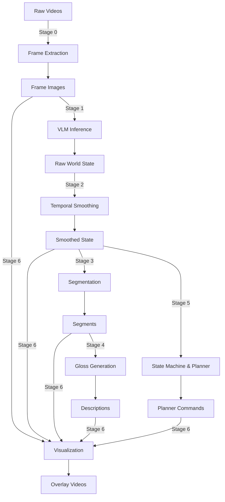

# Autonomous Driving World Model (DWM)

Modern autonomous driving systems increasingly use end-to-end neural networks that map sensory input directly to control actions. These approaches are powerful but provide limited access to intermediate reasoning.

This project makes that intermediate layer explicit. A 7-stage pipeline converts dashcam video into symbolic world states describing **action feasibility** (what the ego vehicle can do), **yield constraints** (what it must yield to), and **agent behavior** (how surrounding actors move). These frame-level predictions are then temporally smoothed, segmented into behavioral phases, and translated into higher-level driving decisions in natural language.

Together, these layers form an interpretable **Driving World Model** that infers what the car should do next and can be visualized. See the [Demo Video](https://raw.githubusercontent.com/YashDThapliyal/VLM-Driving-World-Model/main/driving_world_model_demo.mp4)


### Object Detection vs World Modeling

Object detection answers: **"What objects are present?"**  
A world model answers: **"What do those objects mean for the ego vehicle?"**

In this project, the green box highlights the **decision target**: the agent that constrains the ego vehicle (for example a pedestrian or a lead vehicle). This illustrates the reason behind the ego vehicle's behavior such as stopping for a pedestrian or following a lead car.

Examples of world model outputs:
- "yield to that specific pedestrian"
- "follow that silver sedan in front until it moves"
- "stop for the crosswalk, then go"

The Driving World Model interprets how scene elements constrain driving behavior, enabling decisions like yielding, stopping, or following.

## What This Does

This system answers three key questions about any driving scene:

| Question | Field | Values |
|----------|-------|--------|
| What can the ego vehicle safely do? | `affordance` | go / wait / stop |
| What is constraining it? | `yield_to` | none / lead / ped |
| What is the lead vehicle doing? | `lead_state` | none / moving / stopped |

Unlike end-to-end driving networks that output raw control signals, this produces **symbolic, human-readable states** that bridge perception and planning—enabling reasoning, debugging, and human validation.

## Pipeline Overview

```
Raw Video → Frames → VLM Analysis → Smoothing → Segmentation → Planner Commands → Visualization
```



## Quick Start

### Prerequisites

```bash
pip install -r requirements.txt
export ANTHROPIC_API_KEY="your-api-key"
```

### Run the Full Pipeline

```bash
# Process a single clip
python main.py --clip clip1

# Process all clips
python main.py --all

# Force recompute (ignore cache)
python main.py --all --force
```

## Pipeline Stages

### Stage 0: Frame Extraction
**Module:** `extract_frames.py`

Extracts frames from MP4 videos at fixed intervals.

### Stage 1: VLM Inference
**Module:** `run_vlm_inference.py` → `vlm_infer.py`

Uses Claude to analyze each frame and output a 3-field world state with explanations. Rate-limited to avoid API throttling.

**Output:** `world_state_claude.csv`

### Stage 2: Temporal Smoothing
**Module:** `temporal_smoothing.py`

Applies sliding-window majority vote (default: 3 frames) to reduce per-frame noise while preserving temporal structure.

**Output:** `world_state_claude_smoothed.csv`

### Stage 3: Segmentation
**Module:** `segment_world_state.py`

Groups consecutive frames with identical states into segments and assigns phase labels (e.g., "STOP behind vehicle", "FOLLOW moving lead").

**Output:** `world_state_segments.csv`

### Stage 4: Gloss Generation
**Module:** `generate_segment_gloss.py`

Uses Claude to generate natural language descriptions for each segment (e.g., "pedestrian crossing ahead").

**Output:** `segment_gloss.csv`

### Stage 5: State Machine & Planner
**Module:** `build_state_and_planner.py`

Builds a symbolic state machine, reinjects brief "GO" opportunities that smoothing may have removed, and generates planner commands (FOLLOW, GO, WAIT, STOP, YIELD).

**Output:** `planner_commands.csv`, `world_state_machine.csv`, `world_state_final.csv`

### Stage 6: Visualization
**Module:** `overlay_world_state.py`

Creates MP4 videos with HUD overlays showing frame info, phase labels, scene descriptions, world state, and planner intent.

**Visual Grounding (YOLO):** During visualization, the system highlights the specific pedestrian or vehicle the planner is reacting to using YOLO object detection. This makes yield and follow behaviors visually grounded and interpretable—viewers can see exactly which object triggered each planner decision.

**Output:** `results/{clip}_overlay.mp4`

## Project Structure

```
driving-affordance-world-model/
├── main.py                     # End-to-end pipeline driver
├── analysis/
│   ├── compute_metrics.py      # Results section metrics
│   └── count_frames.py         # Frames per clip
├── src/
│   ├── extract_frames.py       # Stage 0
│   ├── run_vlm_inference.py    # Stage 1 (orchestrator)
│   ├── vlm_infer.py            # Stage 1 (inference logic)
│   ├── temporal_smoothing.py   # Stage 2
│   ├── segment_world_state.py  # Stage 3
│   ├── generate_segment_gloss.py # Stage 4
│   ├── build_state_and_planner.py # Stage 5
│   ├── overlay_world_state.py  # Stage 6
│   ├── eval_world_model.py     # Evaluation
│   └── schema.py               # Data schema definitions
├── data/
│   ├── raw_videos/             # Input MP4 files
│   ├── frames/                 # Extracted frame images
│   ├── predictions/            # All intermediate CSVs
│   └── labels/                 # Human annotations (optional)
└── results/                    # Output overlay videos
```

## Running Individual Stages

```bash
python -m src.extract_frames
python -m src.run_vlm_inference
python -m src.temporal_smoothing
python -m src.segment_world_state
python -m src.generate_segment_gloss
python -m src.build_state_and_planner
python -m src.overlay_world_state --clip clip1 --fps 2
python -m src.eval_world_model
```

## Evaluation

`eval_world_model.py` compares predictions against human-annotated ground truth in `data/labels/` to compute:
- Accuracy metrics
- Safety-critical error rates
- Per-field performance breakdowns

## Results

Run on 9 dashcam clips (`clip1`–`clip9`) from the [driving-test dataset](https://www.kaggle.com/datasets/snmahsa/driving-test), sampled at 2 fps: **211 frames, about 105 seconds of driving**. Every number below comes from the CSVs in `data/predictions/` and can be regenerated with:

```bash
python analysis/compute_metrics.py          # add --export_csv metrics.csv to save a table
```

### Temporal smoothing cuts label jitter by 46%

A "flip" is a frame where a field's label differs from the previous frame of the same clip. Fewer flips means the world state stops flickering between, say, `go` and `wait` on consecutive frames.

| Field | Flips before smoothing | Flips after | Reduction |
|-------|-----------------------:|------------:|----------:|
| `affordance` | 32 | 13 | 59.4% |
| `yield_to` | 39 | 25 | 35.9% |
| `lead_state` | 35 | 19 | 45.7% |
| **All three fields** | **106** | **57** | **46.2%** |

Mean run length (frames a label holds before changing) rises from 5.2 to 9.6 for `affordance`.

### From frames to phases to decisions

| Stage | Count | What it is |
|-------|------:|------------|
| Frames | 211 | per-frame world states from the VLM |
| Phase segments | 43 | runs of frames sharing a phase, drawn from **7 phase types** (e.g. *FOLLOW / queue*, *YIELD to pedestrian*, *STOP behind vehicle*) |
| Planner decisions | 52 | state-machine steps, each mapped to one of **4 commands**: FOLLOW (19), WAIT (17), GO (10), STOP (6) |

The most common phase is *FOLLOW / queue* (17 of 43 segments), followed by *YIELD to pedestrian* (9).

### Overlay videos

All 9 annotated clips are in [`results/`](results/) (`clip1_overlay.mp4` … `clip9_overlay.mp4`).

### Scope

These are pipeline statistics on 9 short clips, not driving-accuracy results. Per-frame accuracy against human labels (`src/eval_world_model.py`) needs annotations in `data/labels/`, which currently cover clips 1–2 only. The raw videos and extracted frames are not committed; download the dataset and run `python main.py --all` to rebuild them.

## Data Flow

| Stage | Input | Output |
|-------|-------|--------|
| 0 | `raw_videos/*.mp4` | `frames/{clip}/frame_*.jpg` |
| 1 | Frame images | `world_state_claude.csv` |
| 2 | Raw predictions | `world_state_claude_smoothed.csv` |
| 3 | Smoothed predictions | `world_state_segments.csv` |
| 4 | Segments | `segment_gloss.csv` |
| 5 | Smoothed + segments | `planner_commands.csv`, `world_state_machine.csv` |
| 6 | All above | `results/{clip}_overlay.mp4` |

## Key Dependencies

- `anthropic` - Claude VLM API
- `ultralytics` - YOLOv8 object detection (for visual grounding)
- `opencv-python` - Video/frame processing
- `Pillow` - Image processing
- `moviepy` - Video generation
- `pandas`, `numpy` - Data processing

## Use Cases

- VLM-based world modeling research for autonomous driving
- Validating vision-language models in safety-critical applications
- Building interpretable intermediate representations between perception and planning
- Foundation for semantic planners that consume VLM-derived world states

Data Source: https://www.kaggle.com/datasets/snmahsa/driving-test?resource=download
